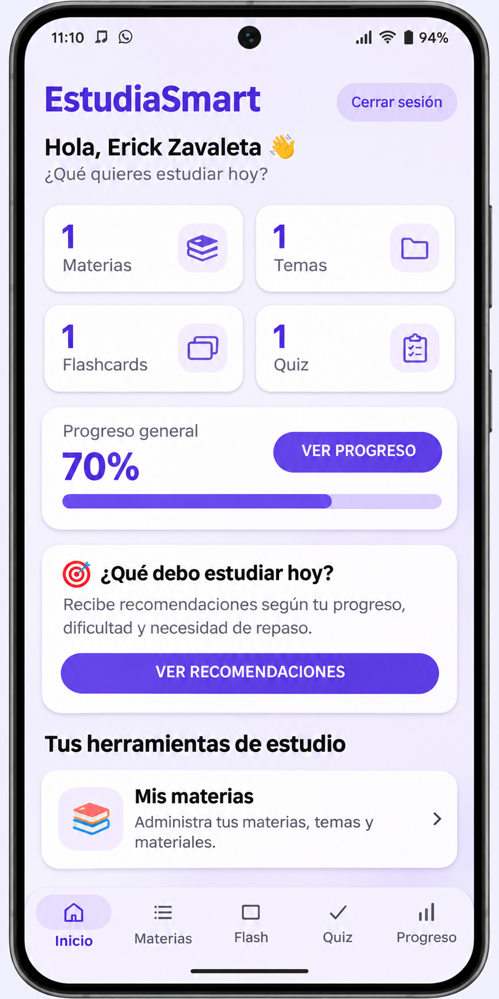
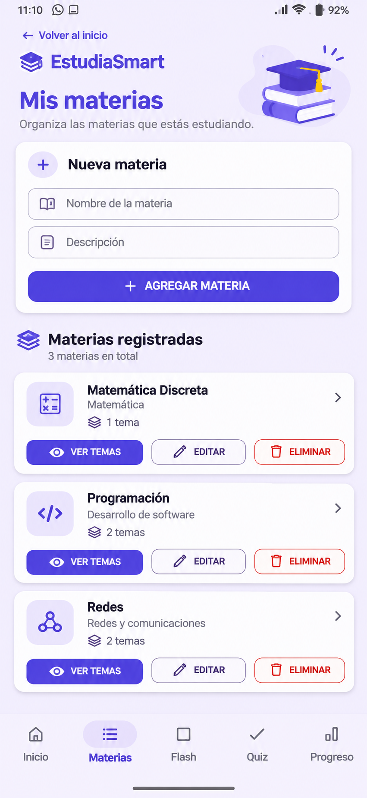

# 📚 EstudiaSmart

**EstudiaSmart** es una aplicación móvil Android desarrollada como proyecto académico para la asignatura **Desarrollo de Software para Móviles DSM941** de la **Universidad Don Bosco**.

La aplicación está orientada a apoyar al estudiante en la organización y seguimiento de su proceso de estudio mediante la administración de materias, temas y materiales, además de herramientas como flashcards, quizzes, seguimiento del progreso y recomendaciones de repaso.

---

## 👥 Integrantes

| Integrante | Carnet |
|---|---|
| Josseline Beatriz Pérez Martínez | PM171434 |
| Erick Roberto Zavaleta Rivera | ZR171491 |

**Docente:** Alexander Alberto Siguenza Campos  
**Asignatura:** Desarrollo de Software para Móviles DSM941  
**Equipo:** 10  
**Año:** 2026

---

## 🎯 Objetivo del proyecto

Desarrollar una aplicación móvil Android que permita al estudiante organizar su información académica, practicar mediante flashcards y quizzes, almacenar sus resultados y utilizar esos datos para visualizar su progreso y recibir recomendaciones de estudio.

---

## 📱 Funcionalidades implementadas

La versión final de EstudiaSmart incorpora:

- Registro de usuarios.
- Inicio de sesión mediante correo electrónico y contraseña.
- Inicio de sesión mediante cuenta de Google.
- Cierre de sesión.
- Persistencia de sesión.
- Gestión de materias.
- Gestión de temas.
- Gestión de materiales de estudio.
- Creación, edición y eliminación de información académica.
- Flashcards.
- Sistema de repetición espaciada.
- Creación de quizzes.
- Administración de preguntas.
- Resolución de quizzes.
- Historial de intentos.
- Cálculo de resultados.
- Progreso por tema.
- Progreso general.
- Recomendaciones de estudio.
- Persistencia de información mediante Cloud Firestore.
- Sincronización de información con Firebase.
- Navegación inferior entre los módulos principales.
- Validaciones de formularios.
- Confirmaciones antes de eliminar información.
- Separación de lógica mediante ViewModels.

---

# 🧠 Lógica de estudio

EstudiaSmart no funciona únicamente como una aplicación CRUD. También incorpora reglas de negocio relacionadas con el aprendizaje y seguimiento del estudiante.

## 🗂️ Flashcards

El módulo de flashcards permite registrar una pregunta y una respuesta asociadas con un tema.

Después de estudiar una tarjeta, el estudiante puede clasificar el repaso como:

- **Difícil**
- **Regular**
- **Fácil**

Según la clasificación realizada, EstudiaSmart actualiza información como:

- dificultad;
- racha;
- cantidad de revisiones;
- próxima fecha de repaso.

Los intervalos base utilizados son:

```text
Difícil  → 1 día
Regular  → 3 días
Fácil    → 7 días
```

De esta manera se implementa una estrategia básica de **repetición espaciada**.

---

## 📝 Quizzes

Los quizzes se asocian con un tema y pueden contener diferentes preguntas.

Cada pregunta puede incluir:

- enunciado;
- opciones de respuesta;
- respuesta correcta.

Cuando el estudiante termina un quiz, EstudiaSmart calcula:

```text
Respuestas correctas
        ↓
Total de preguntas
        ↓
Porcentaje obtenido
        ↓
Registro del intento
```

Los resultados se almacenan en Cloud Firestore para conservar el historial.

---

## 📊 Progreso

EstudiaSmart utiliza los resultados obtenidos en las actividades de estudio para mostrar el nivel de dominio del estudiante.

El progreso de un tema combina principalmente el rendimiento obtenido en:

```text
Quizzes      → 70 %
Flashcards   → 30 %
```

Según el resultado obtenido, los temas pueden clasificarse como:

```text
Menos de 60 %   → Requiere refuerzo
60 % - 79 %     → En progreso
80 % o más      → Dominio alto
```

---

## 💡 Recomendaciones de estudio

El módulo **¿Qué debo estudiar hoy?** analiza la información académica disponible para determinar qué temas requieren mayor atención.

La recomendación considera factores como:

- nivel de dominio;
- tiempo desde el último repaso;
- dificultad registrada.

La lógica de prioridad utiliza como referencia:

```text
50 % → Debilidad del dominio
30 % → Urgencia de repaso
20 % → Dificultad
```

Esto permite que EstudiaSmart genere recomendaciones basadas en el desempeño del estudiante.

---

# 🏗️ Arquitectura de la aplicación

Durante la fase final del proyecto se mejoró la separación de responsabilidades mediante el uso de **ViewModels**.

La arquitectura general utilizada puede representarse de la siguiente manera:

```text
Usuario
   ↓
Jetpack Compose
   ↓
Screens
   ↓
ViewModels
   ↓
Repositories / Services
   ↓
Firebase Authentication / Cloud Firestore
```

Entre los principales ViewModels implementados se encuentran:

```text
HomeViewModel
AuthViewModel
AcademicViewModel
FlashcardViewModel
QuizViewModel
```

El uso de ViewModel permite mantener la lógica de la aplicación separada de los componentes visuales desarrollados con Jetpack Compose.

---

# 🧭 Navegación

Las principales funciones de EstudiaSmart pueden consultarse mediante una barra de navegación inferior.

Las opciones principales son:

```text
Inicio | Materias | Flash | Quiz | Progreso
```

La navegación secundaria permite acceder a otras pantallas como:

```text
Materia
   ↓
Temas
   ↓
Materiales
```

También puede accederse desde el Dashboard al módulo de recomendaciones de estudio.

---

# 🔥 Firebase

EstudiaSmart utiliza servicios de Firebase para autenticación y persistencia.

## Firebase Authentication

Se implementaron dos métodos principales de autenticación:

```text
Correo electrónico + contraseña
Google
```

Firebase Authentication proporciona el UID del usuario autenticado.

Ese UID se utiliza posteriormente para identificar la información correspondiente al estudiante dentro de Cloud Firestore.

---

## ☁️ Cloud Firestore

Cloud Firestore almacena la información académica de cada usuario.

La estructura general utilizada es:

```text
usuarios
└── {uid}
    ├── uid
    ├── correo
    ├── nombre
    ├── ultimoAcceso
    │
    ├── materias
    │   └── {materiaId}
    │
    ├── temas
    │   └── {temaId}
    │
    ├── materiales
    │   └── {materialId}
    │
    ├── flashcards
    │   └── {flashcardId}
    │
    ├── quizzes
    │   └── {quizId}
    │
    └── historialQuiz
        └── {intentoId}
```

---

## 🔐 Seguridad de Firestore

La información se encuentra separada mediante el UID proporcionado por Firebase Authentication.

Las reglas de seguridad verifican que el usuario autenticado únicamente pueda acceder a la información correspondiente a su propio identificador.

La validación principal utilizada es:

```text
request.auth != null
request.auth.uid == userId
```

Esto evita que un usuario pueda consultar o modificar directamente la información perteneciente a otro usuario.

---

# 🔄 Sincronización

Los repositorios utilizan listeners de Cloud Firestore para recibir cambios en la información almacenada.

El flujo general es:

```text
Inicio de sesión
      ↓
UID del usuario
      ↓
Repository
      ↓
Listener de Firestore
      ↓
Información recibida
      ↓
ViewModel
      ↓
Jetpack Compose
      ↓
Interfaz actualizada
```

Esto permite mantener sincronizados los datos almacenados en Firebase con la aplicación.

---

# 🗑️ Eliminación relacionada

La aplicación también maneja las relaciones entre la información académica.

Por ejemplo, al eliminar un tema se eliminan los registros relacionados que corresponda, como:

- materiales;
- flashcards;
- quizzes;
- historial relacionado con esos quizzes.

De forma similar, al eliminar una materia se procesan sus temas y la información asociada.

Esto evita mantener registros académicos sin una relación válida.

---

# 🎨 Interfaz y experiencia de usuario

La interfaz final fue desarrollada con **Jetpack Compose y Material 3**.

Durante la fase final se realizaron mejoras de:

- contraste;
- legibilidad;
- consistencia visual;
- colores;
- navegación;
- organización de información.

Las principales pantallas mantienen una identidad visual clara y una navegación consistente.

---

# 🛠️ Tecnologías utilizadas

| Tecnología | Uso |
|---|---|
| Kotlin | Lenguaje principal |
| Android Studio | Entorno de desarrollo |
| Jetpack Compose | Desarrollo de interfaz |
| Material 3 | Componentes visuales |
| Navigation Compose | Navegación entre pantallas |
| ViewModel | Separación entre UI y lógica |
| Firebase Authentication | Autenticación |
| Cloud Firestore | Persistencia de información |
| Credential Manager | Autenticación mediante Google |
| Git | Control de versiones |
| GitHub | Repositorio colaborativo |

---

# 🎨 Mockups y diseño

Los mockups finales utilizados como referencia visual para EstudiaSmart se encuentran almacenados directamente dentro del repositorio.

Carpeta:

```text
mockups/
```

## Mockups incluidos

### Login


### Inicio



### Materias



### Flashcards


### Quiz


### Progreso


---

## 🎨 Diseño en Figma

La propuesta visual completa también puede consultarse en Figma:

[Ver mockups finales de EstudiaSmart en Figma](https://www.figma.com/design/t3uVBOb7kET1yPdBCo9Jze/EstudiaSmart---Mockups-Finales?node-id=0-1&t=SXyq9NuOLYLeYIwU-1)

Los archivos principales utilizados para la entrega también permanecen almacenados dentro del repositorio.

---

# 📄 Documentación final

El documento acumulativo del proyecto se encuentra almacenado dentro de la carpeta:

```text
documentacion/
```

Documento:

📄 [Proyecto Final EstudiaSmart – Fase III](documentacion/Proyecto_Final_EstudiaSmart_Integrado_Fase_III.pdf)

El documento integra el desarrollo realizado durante las fases anteriores y la fase final del proyecto.

Incluye:

- descripción del proyecto;
- objetivos;
- Firebase Authentication;
- Cloud Firestore;
- arquitectura;
- persistencia;
- flashcards;
- quizzes;
- historial;
- seguridad;
- pruebas realizadas;
- evidencias;
- trabajo colaborativo;
- evaluación final;
- matriz de calidad;
- resultados;
- oportunidades de mejora;
- conclusiones.

---

# 🎥 Video de demostración / defensa

El video correspondiente a la entrega final será incorporado antes de la entrega definitiva.

```text
VIDEO FINAL: PENDIENTE DE AGREGAR
```

Cuando el video se encuentre publicado, este apartado se actualizará con el enlace correspondiente.

---

# 🧪 Pruebas realizadas

Durante el desarrollo se realizaron pruebas sobre las principales funcionalidades.

## Autenticación

```text
✅ Registro
✅ Login mediante correo y contraseña
✅ Login mediante Google
✅ Persistencia de sesión
✅ Cierre de sesión
```

## Gestión académica

```text
✅ Crear materia
✅ Editar materia
✅ Eliminar materia

✅ Crear tema
✅ Editar tema
✅ Eliminar tema

✅ Crear material
✅ Editar material
✅ Eliminar material
```

## Flashcards

```text
✅ Crear flashcard
✅ Editar flashcard
✅ Eliminar flashcard
✅ Registrar repaso
✅ Modificar dificultad
✅ Modificar racha
✅ Modificar revisiones
✅ Calcular próxima revisión
```

## Quiz

```text
✅ Crear Quiz
✅ Crear preguntas
✅ Resolver Quiz
✅ Calcular resultado
✅ Guardar intento
✅ Recuperar historial
```

## Progreso

```text
✅ Calcular progreso por tema
✅ Mostrar progreso general
✅ Clasificar dominio
✅ Generar recomendaciones
```

## Persistencia

También se realizó la prueba:

```text
Crear información
      ↓
Cerrar completamente EstudiaSmart
      ↓
Abrir nuevamente
      ↓
Recuperar información desde Firestore
```

**Resultado: correcto.**

---

# 👨‍💻 Trabajo colaborativo y Git

El proyecto fue desarrollado utilizando Git y GitHub.

Repositorio:

https://github.com/robertoz04/EstudiaSmart

Durante el desarrollo se utilizaron diferentes ramas para mantener separado el trabajo de cada integrante.

Entre las ramas utilizadas durante la fase final se encuentran:

```text
fase-final-viewmodel-roberto
fase-final-beatriz
```

### Trabajo de Erick Roberto Zavaleta Rivera

Entre sus principales aportes durante la fase final se encuentran:

- HomeViewModel;
- AuthViewModel;
- AcademicViewModel;
- FlashcardViewModel;
- QuizViewModel;
- mejoras en navegación;
- barra de navegación inferior;
- ajustes visuales;
- pruebas de funcionamiento.

### Trabajo de Josseline Beatriz Pérez Martínez

Entre sus principales aportes durante la fase final se encuentran:

- documentación;
- mockups;
- organización de recursos de entrega;
- licencia Creative Commons;
- actualización de README;
- integración de evidencias;
- documentación de la fase final.

Finalmente, las ramas se integran en `main` para formar la versión definitiva de EstudiaSmart.

---

# 📂 Estructura general del repositorio

```text
EstudiaSmart/
│
├── android-app/
│   └── Aplicación Android
│
├── documentacion/
│   └── Proyecto_Final_EstudiaSmart_Integrado_Fase_III.pdf
│
├── mockups/
│   ├── login.png
│   ├── inicio.png
│   ├── materias.png
│   ├── flashcards.png
│   ├── quiz.png
│   └── progreso.png
│
├── LICENSE.md
└── README.md
```

---

# ▶️ Ejecución del proyecto

Para ejecutar EstudiaSmart:

1. Clonar el repositorio:

```bash
git clone https://github.com/robertoz04/EstudiaSmart.git
```

2. Abrir la siguiente carpeta con Android Studio:

```text
EstudiaSmart/android-app
```

3. Esperar la sincronización de Gradle.

4. Conectar un dispositivo Android o utilizar un emulador.

5. Ejecutar el módulo:

```text
app
```

La aplicación necesita conexión a Internet para utilizar Firebase Authentication y Cloud Firestore.

---

# 📦 Compilación

Desde la carpeta `android-app` puede comprobarse la compilación mediante:

```bash
./gradlew :app:assembleDebug
```

Para instalar la versión Debug directamente en un dispositivo conectado:

```bash
./gradlew :app:installDebug
```

---

# 📜 Licencia

EstudiaSmart incorpora una licencia **Creative Commons Attribution-NonCommercial 4.0 International (CC BY-NC 4.0)** para la documentación, diseño y materiales propios del proyecto.

La licencia completa puede consultarse dentro del repositorio:

📜 [Consultar LICENSE.md](LICENSE.md)

---

# ✅ Estado del proyecto

La versión final de **EstudiaSmart** integra:

```text
Kotlin
Jetpack Compose
Material 3
Navigation Compose
ViewModel
Firebase Authentication
Google Sign-In
Cloud Firestore
Security Rules
Persistencia remota
Materias
Temas
Materiales
Flashcards
Repetición espaciada
Quizzes
Historial
Progreso
Recomendaciones
Mockups
Documentación
Git y GitHub
```

**Estado: funcional para la entrega académica final.**

---

© 2026 Josseline Beatriz Pérez Martínez y Erick Roberto Zavaleta Rivera.  
Universidad Don Bosco.